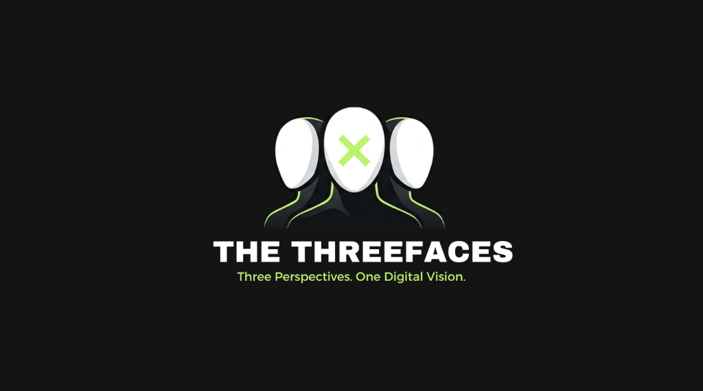

# The ThreeFaces — Digital Architecture & Engineering Studio

Official website and digital showcase for **The ThreeFaces**, a modern software design and web engineering studio building high-performance web applications, digital commerce, and automated business workflows.



## Tech Stack

- **Framework**: React 19 + TypeScript + Vite
- **Styling**: Tailwind CSS v4
- **Animation**: Framer Motion (60fps fluid physics-based gestures)
- **Icons**: Lucide React
- **Typography**: Syne / Plus Jakarta Sans & Apple New York accent serifs
- **Linting & Code Quality**: Oxlint

## Features

- **Apple-grade Physics Motion**: Spring-driven cards, subtle scale effects, and frictionless micro-interactions.
- **Dynamic Portfolio Layout**: Automatically adapts to a vertical editorial layout if fewer than 3 projects are present, or a balanced 3-column showcase when 3 or more projects are configured.
- **The Shawon Design Language**: Minimal obsidian dark background (`#0A0B0D`), high-contrast typography, and electric lime accent (`#B9F36B`).
- **Interactive Verification Modules**: 4.9/5 verified client review deck, interactive FAQs, and 4-step progressive process showcase.
- **Accessible & Responsive**: Fully responsive across mobile, tablet, and desktop with zero layout shift.

## Getting Started

### Prerequisites

- Node.js (v18+ recommended)
- npm or pnpm

### Installation

```bash
npm install
```

### Development

```bash
npm run dev
```

### Production Build

```bash
npm run build
```

### Preview Production

```bash
npm run preview
```

## License

Private / All rights reserved © The ThreeFaces.
